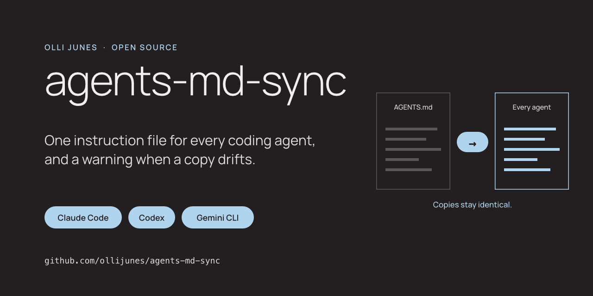

# agents-md-sync



[](https://github.com/ollijunes/agents-md-sync/actions/workflows/ci.yml)
[](pyproject.toml)
[](LICENSE)

Write your instructions for coding agents once. agents-md-sync copies that
one file to the place each tool reads, and tells you when a copy has been
changed behind your back.

Claude Code reads `~/.claude/CLAUDE.md`. Codex reads `~/.codex/AGENTS.md`.
Gemini CLI reads `~/.gemini/GEMINI.md`. If you use more than one of them,
you keep the same rules in several files, and after a few weeks they
disagree. Agents also write to these files themselves, so a copy can change
without you touching it.

agents-md-sync keeps one source file and treats every other file as a
generated copy. `publish` writes the copies. `check` compares them and exits
with an error code when one differs, so a cron job, a session hook or CI can
tell you. A copy that was edited since the last publish is never overwritten
without a backup.

[Security](SECURITY.md) · [Contributing](CONTRIBUTING.md) ·
[ollijunes.com](https://ollijunes.com)

Read the story behind it: [in English](https://ollijunes.com/agents-md-sync-one-instruction-file-for-every-coding-agent/) · [suomeksi](https://ollijunes.com/fi/agents-md-sync-yksi-ohjetiedosto-kaikille-koodausagenteille/).

## Who it is for

People who use two or more coding agents on the same machine, or who keep
`AGENTS.md`, `CLAUDE.md` and `GEMINI.md` side by side in a repository, and
want them to say the same thing.

## Install

You need Python 3.11 or newer. There are no other dependencies.

```sh
uv tool install git+https://github.com/ollijunes/agents-md-sync
agents-md-sync --version
```

`pipx install git+https://github.com/ollijunes/agents-md-sync` works too.

## Set up

Pick the file you want to edit from now on. It can live anywhere, for
example in a notes or dotfiles repository.

```sh
agents-md-sync init --source ~/notes/AGENTS.md
```

```text
Wrote ~/.config/agents-md-sync/config.toml
  target: ~/.claude/CLAUDE.md
  target: ~/.codex/AGENTS.md
  target: ~/.gemini/GEMINI.md
Next: agents-md-sync check
```

Paths you give `init` are relative to the current folder. `init` adds every
tool whose folder it finds. Name them yourself with
`--tool claude --tool codex`, and add any other path with `--target`.

```sh
agents-md-sync publish
```

```text
created: ~/.claude/CLAUDE.md
created: ~/.codex/AGENTS.md
created: ~/.gemini/GEMINI.md
3 written, 0 already up to date (74 bytes).
```

If a tool already has an instruction file with other content, `publish`
stops and writes nothing. Move what you want to keep into the source file
first. `agents-md-sync diff` shows the difference.

## Day to day

Edit the source, then publish. To find out whether anything drifted:

```sh
agents-md-sync check
```

```text
edited: ~/.claude/CLAUDE.md (changed since the last publish)
stale: ~/.codex/AGENTS.md (an older copy; publish updates it)
stale: ~/.gemini/GEMINI.md (an older copy; publish updates it)
A copy was changed by hand or by an agent. Run `agents-md-sync diff`.
```

| Status | Meaning | `publish` |
| --- | --- | --- |
| `same` | Identical to the source | Leaves it alone |
| `stale` | The copy from the last publish; the source has changed since | Updates it |
| `missing` | The tool's folder exists, the file does not | Creates it |
| `edited` | Differs from the source and from the last publish | Stops, writes nothing |
| `linked` | A symlink to the source | Leaves it alone |
| `no-folder` | The tool's folder does not exist | Skips it |
| `blocked` | A directory, or a symlink to somewhere else | Stops, writes nothing |

An `edited` copy usually means an agent saved a note into its own
instruction file, or you fixed something in the wrong place.

```sh
agents-md-sync diff
```

```diff
--- source
+++ ~/.claude/CLAUDE.md
@@ -1,4 +1,4 @@
 # Shared instructions

 Answer briefly. Run the tests before you say done.
-Use British spelling.
+- The user prefers tabs.
```

Copy the lines you want into the source and publish again. If you want none
of them, `agents-md-sync publish --force` overwrites the copy and keeps the
old one under `~/.local/state/agents-md-sync/backups/`.

`publish --dry-run` shows what would be written. The output above comes from
a synthetic home folder.

## Exit codes

| Exit | Meaning |
| --- | --- |
| 0 | Everything is in sync, or publish succeeded |
| 1 | Config or source problem, or a file could not be written |
| 3 | `check`: a copy is stale or missing. `publish` fixes it |
| 4 | A copy was edited or is blocked. It needs you |

`check --quiet` prints only the copies that differ, and nothing when all is
well. That makes it usable as a session-start hook or a cron line:

```sh
agents-md-sync check --quiet || echo "agent instructions drifted"
```

## In a repository

The same tool keeps the per-tool files of a project identical. Put
`.agents-md-sync.toml` in the repository root:

```toml
source = "AGENTS.md"
targets = ["CLAUDE.md", "GEMINI.md", ".github/copilot-instructions.md"]
```

Or let `init` write it, from the repository root:

```sh
agents-md-sync init --project --source AGENTS.md --target CLAUDE.md --target GEMINI.md
```

Relative paths start at the config file's folder. Run `agents-md-sync
publish` in the repository after editing `AGENTS.md`. In CI, `agents-md-sync
check` fails when a copy differs. A config in the current folder wins over
the one in your home folder.

A file named `.agents-md-sync.toml` may come from a repository someone else
wrote, so it is confined to its own folder. It takes relative paths only,
cannot use `tools`, and is refused when the source or a target lies outside
the folder, also through a symlink. Running `publish` in a cloned repository
cannot replace an instruction file in your home folder.

## Configuration

```toml
source = "~/notes/AGENTS.md"
tools = ["claude", "codex", "gemini"]
targets = ["~/dotfiles/agents/AGENTS.md"]
min_bytes = 200
max_bytes = 32768
heading = "# Shared instructions"
```

| Key | Meaning |
| --- | --- |
| `source` | The one file you edit |
| `tools` | Built-in locations, see below |
| `targets` | Any other file that should be a copy |
| `min_bytes`, `max_bytes` | `publish` refuses a source outside these sizes. An empty or cut-off file is not copied over good ones. The default upper limit is 32 KiB, the size at which Codex stops reading by default |
| `heading` | If set, the source must start with exactly this line, so a wrong file is never published |

Built-in locations, each taken from the tool's own documentation:

| Name | Tool | File | Folder override |
| --- | --- | --- | --- |
| `claude` | Claude Code | `~/.claude/CLAUDE.md` | `CLAUDE_CONFIG_DIR` |
| `codex` | Codex CLI | `~/.codex/AGENTS.md` | `CODEX_HOME` |
| `gemini` | Gemini CLI | `~/.gemini/GEMINI.md` | |
| `opencode` | opencode | `~/.config/opencode/AGENTS.md` | |

`agents-md-sync tools` shows where each one points on your machine. For any
other tool, add its file to `targets`.

The config is read from `--config`, then `AGENTS_MD_SYNC_CONFIG`, then
`./.agents-md-sync.toml`, then `~/.config/agents-md-sync/config.toml`. What
was published is recorded in `~/.local/state/agents-md-sync/state.json`
(`XDG_CONFIG_HOME` and `XDG_STATE_HOME` are honoured).

## Limitations

- Copies are byte-for-byte identical. There is no per-tool section, no
  templating and no format conversion. If one tool needs different rules,
  this is the wrong tool.
- It does not merge. When a copy was edited, you move the lines into the
  source yourself.
- The record of what was published is per machine. On a new machine, or in
  CI, an old copy counts as `edited` instead of `stale` until the first
  publish there.
- `check` in CI needs no record: it passes only when every copy is
  identical.
- Tools change where they read instructions from. The built-in list is
  short on purpose and holds only documented locations.
- macOS and Linux. Windows is untested.

## How it compares

A symlink from each tool's file to one source does the same job with no
tool at all, and agents-md-sync leaves such links alone. Copies are for the
cases where a symlink is a problem: a tool or a sync service that replaces
the link with a file, a repository that should work on a fresh checkout, or
a file an agent rewrites. Claude Code can also import another file with an
`@path` line. That covers Claude Code only.

## Development

```sh
uv sync --locked
uv run python -m pytest --cov=agents_md_sync --cov-fail-under=90
uv run ruff check .
uv run ruff format --check .
python3 scripts/check_public_tree.py
```

The tests use a synthetic home folder in a temporary directory and never
read your real instruction files.

## License

[MIT](LICENSE). Made by [Olli Junes](https://ollijunes.com). Powered by [ResaHost](https://resahost.net/en/). Not affiliated
with Anthropic, OpenAI, Google or the opencode project.
